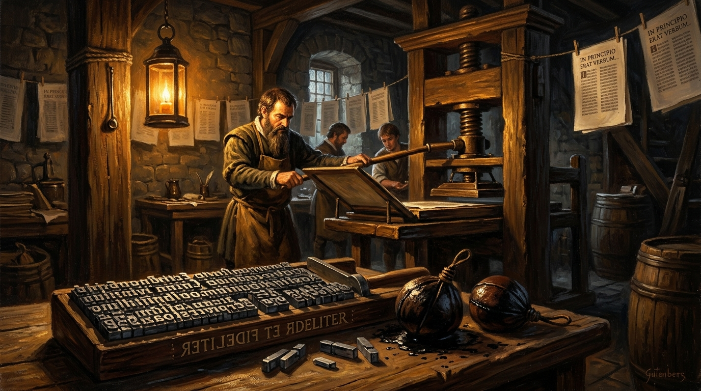
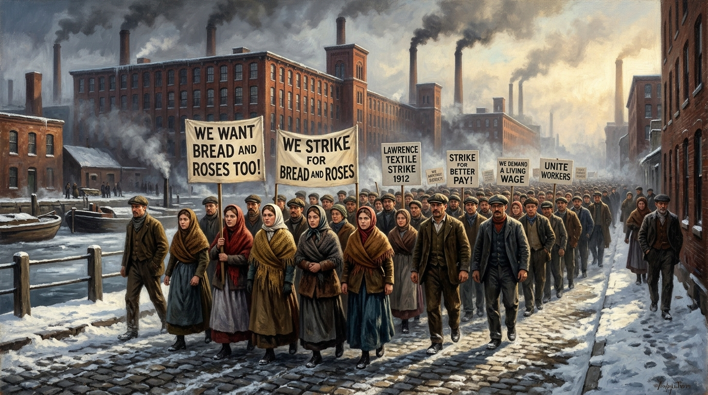
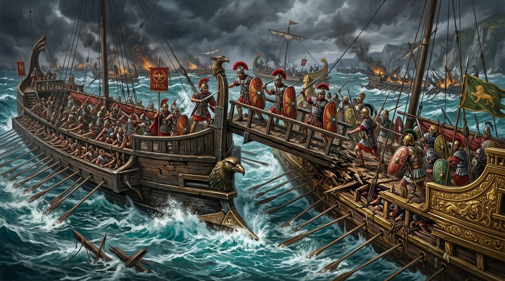

---
# ==============================================================================
# BLOG POST TEMPLATE & FRONTMATTER CONFIGURATION
# Copy this file or use: npm run new:post "Your Post Title"
# Note: Files named 'template.md' or starting with '_' are ignored during build.
# ==============================================================================

# [Required] Title of your article (displayed as the main H1, page title, and card title)
title: "Fanciful mundane anecdote of an egregious and pertenicious writer"

# [Required] Publication date in YYYY-MM-DD format (used for display and sorting)
date: "2026-11-06"

# [Required] Short summary (1-2 sentences). Used for card description and SEO meta tags.
description: "A rich collection of historical and narrative vignettes spanning ancient bronze-age myths, Gutenberg's typography revolution, Cold War espionage, and engineering dilemmas."

# [Optional] Estimated read time (if omitted, automatically calculated from word count)
readTime: "2 hr read"

# ------------------------------------------------------------------------------
# OPTIONAL ADVANCED FIELDS (Uncomment to enable):
# ------------------------------------------------------------------------------
coverImage: "/assets/images/stories/story-2-gutenberg.jpg"
coverCaption: "Johannes Gutenberg in his 15th-century Mainz workshop casting movable lead type."
coverAlt: "Gutenberg's workshop with movable metal type and screw press"
# keywords: ["Machine Learning", "Optimization"]
author: "Md. Muqtadir Fuad"
# authorBio: false # Set to false if you don't want the author bio box at the bottom
---

<!-- ======================================================================== -->
<!-- ARTICLE BODY STARTS HERE (Standard Markdown)                             -->
<!-- ======================================================================== -->
## Story One: The Blood Price of Asphodel

In the bronze age of Peloponnese, when Mycenaean kings still claimed descent from Zeus, the perilous and narrow strait of Salamis was bedeviled by a pervasive curse. Dark omens in the limpid coastal waters seemed to portend ruin for King Menelaus’s fractious fleet, which had grown sluggish and somnolent while awaiting favorable winds. Though a stoic commander of sharp tactical acumen, the king was surrounded by complacent and myopic advisors whose rudimentary grasp of sea lore could only hamper the voyage.

To expedite their departure, Menelaus summoned Calchas, an eccentric seer with a predilection for esoteric rites. The prophet was the exact antithesis of the boisterous, ostentatious Mycenaean warlords; he lived a spartan existence and chose to eschew royal gold. With a slow, provincial drawl, Calchas mocked the court’s sham piety and satirical ballads. He refused to offer perfunctory obeisance to the throne, nor would he feign a mawkish sympathy for the nobles who began to lament their stalled ambitions.

During a clandestine midnight council, while deliberating over a cumbersome bronze astrolabe, the pensive seer made a deliberate accusation. He claimed a furtive, rapacious chieftain had committed a seemingly slight offense: slaying a sacred stag in a meadow of pale asphodel blossoms. No salutary herb or earthly panacea could exculpate the fleet or preclude the goddess Artemis’s wrath.

The accused warlord, a truculent and churlish brute, tried to remain nonchalant and evasive, even attempting to avow that his captains were merely partial to hunting wild game. Yet the fastidious priest demanded a chivalrous sacrifice that would supersede all royal decrees. With his bowstring pulled taut, the king had no choice but to sever his alliance with the offending lord, taking no relish in the blood price required to make the wind indispensable to their sails blow once more.

## Story Two: The Lead Alloy Awakening: Gutenberg, Typography, and the Death of the Medieval Information Monopoly

When Johannes Gutenberg introduced movable metal type to urban Mainz, he shattered a lethargic medieval monopoly that was no longer tenable. Previously, scribes treated copying manuscripts as a numinous vocation within a Byzantine guild network, though manual transcription remained an onerous task where one sleepy error could vitiate a documentary record and perpetuate mistakes for centuries. Wealthy patrons—along with every courtly sycophant—initially dismissed mechanical printing with cavalier disdain, preferring baroque illuminated borders over what they considered a superficial, illusory novelty. Yet Gutenberg’s canny metallurgy produced interchangeable, economically fungible lead letters designed to mimic script and convert ink into a credible, exhilarating rival to calligraphy.

Unfortunately, Gutenberg’s partnership with Johann Fust collapsed into an acrimonious lawsuit. Far from altruistic, the parsimonious Fust grew exasperated after an exhaustive audit, foreclosed on the workshop, and watched Gutenberg’s fortune dwindle while turning the press into a lucrative business. Soon, typography began to diffuse across Europe and eclipse hand-copied texts. Printers with an affinity for rational clarity stripped away verbose, extraneous commentaries to print pellucid, encyclopedic volumes, leaving distressed scribes behind.

Rather than acting as a purely beneficent metaphorical light, however, the press served to exacerbate religious strife. In 1517, provocative, scathing, and belligerent pamphlets turned Martin Luther’s peripheral academic protest into an overt rebellion fueled by revolutionary fervor. Rejecting conciliatory compromise, Church authorities viewed this tempestuous flood of laconic broadsheets as an unforgivable transgression. Refusing to countenance challenges to magisterial dogma, Rome deployed invidious censorship and public opprobrium to force heretics to renounce their books—a futile effort against an obscure German invention whose impact makes even hackneyed modern comparisons feel incongruous.

## Story Three: The Pelton Wheel Fallacy

During the second-year fluid mechanics sessional at the university, Porter agreed to collaborate with Sara on building a miniature Pelton wheel turbine. Though naturally reticent, Porter felt an inborn affinity for her, disguising his romantic fervor behind an altruistic willingness to debug her MATLAB scripts at two in the morning. Their departmental advisor was an exacting professor whose stringent grading rubrics and astringent, scathing critiques left half the sophomores flummoxed. Yet working beside Sara beneath the flickering fluorescent lights of the machine shop felt exhilarating to Porter, shaking him out of his usual post-lecture torpor and lethargic routine. He was a competent and adroit CAD designer, always ready to amend a flawed impeller drawing or trim extraneous, diffuse paragraphs from their lab reports until the technical methodology was pellucid and exhaustive.

However, Sara’s attention had already drifted toward Chase, a self-styled campus polymath and versatile debater from their section. To Porter, Chase was an elitist showman who hid a superficial grasp of thermodynamics behind baroque vocabulary and a Byzantine web of excuses whenever group work was due. While Porter refused to deride Chase openly, he watched with quiet animus as Sara became an eager apologist for Chase’s wayward lab attendance. Whenever Chase offered a conciliatory smile or mimiced the professor’s quirks, Sara’s guarded countenance softened with overt admiration. During fluid lab hours, Porter began noticing subtle, surreptitious glances and covert text messages passing between them across the hydraulic bench—a tantalizing proximity that reminded Porter how divorced his rational engineering mind was from the mechanics of her heart.

The breaking point arrived on the afternoon of the final pump-efficiency demonstration. Sara asked if they could add Chase’s name to their documentary data sheet so he wouldn't fail the sessional—a compromise that felt tantamount to erasing Porter’s sleepless weeks in the workshop. Taking quiet umbrage at the request, Porter realized he had allowed himself to become entirely subservient to her wishes, acting as a discreet academic safety net while she chased another classmate. Still, unable to bear her anxious expression, he chose to acquiesce to the invidious arrangement without a word of protest.

That evening, standing outside the mechanical annex as autumn rain blurred the campus streetlights, Porter finally confronted the illusory nature of his devotion. Any credible hope that his fruitful engineering partnership with Sara would correlate to romance was utterly futile. There was no numinous destiny waiting to reward his silent loyalty, nor could any trenchant equation dictate who she chose to love. Refusing to perpetuate his own heartbreak around an obscure, metaphorical dream, Porter handed Sara the bound project report, wished her and Chase well, and walked back to his dorm hall alone.

## Story Four: The Cipher of Sector Four

In the winter of 1961, behind the heavy velvet curtain of divided Berlin—where orders to curtail border crossings had just been finalized—cryptographer Viktor Mahler worked inside a windowless listening post. His task was to elucidate an inscrutable Soviet one-time pad whose mathematical structure seemed to antedate modern computer ciphers. While his feckless superiors wallowed in bureaucratic apathy and monotonous committee meetings, Viktor remained thorough and judicious. He refused to let the entrenched orthodoxy of the agency inhibit his iconoclastic methods. For months, he had chosen to immure himself in the basement vault to ruminate over peculiar frequency anomalies and refine a synoptic overview of Warsaw Pact transmissions. Though his divergent theories threatened to alienate him from the directorate’s consensus, a lucid breakthrough finally left him quietly elated.

The intercepted cables exposed "Vesper," a sophisticated double agent operating under the cloak of a West German trade attaché. Publicly, Western officials chose to lionize the attaché as a visionary diplomat of impeccable propriety and understated charm, allowing him to enchant high-society salons with exotic tales and the sheer scintillation of his wit. In reality, he was an unscrupulous, profligate operative whose exploitative network thrived on ideological strife. Apropos of the upcoming Geneva summit, Vesper had begun to premeditate a sensational betrayal that would violate every allied security protocol in an already volatile sector. To gratify his Moscow handlers, he intended to distort NATO radar assessments and forsake three field couriers to certain execution.

When Viktor presented pertinent proof of the mole’s virulent treason, the station chief began to bridle with defensive rage. Vociferous counterintelligence deputies questioned the veracity of the decrypted logs, apt to protect their prized asset rather than heed a basement analyst's warning. Ordered to comply with a gag directive, relinquish his notebooks, and banish all suspicion of the attaché for the foreseeable future, Viktor stood crestfallen. He realized that letting this bureaucratic rot fester while trying to reconcile the agency's recondite political games with his conscience would cost lives.

That night, stripping away all superfluous caution, Viktor decided to improvise a daring extraction in the Tiergarten fog. Meeting a skittish field courier beside a bombed-out cathedral, he handed over the raw cipher key so the doomed operatives could evade the KGB trap before dawn.

## Story Five: The Separation Gap on Valve Three

In December 2008, after Space Shuttle *Endeavour* returned from STS-126 with an erratic pressure signature in its main propulsion system, NASA propulsion engineer Bill Gerstenmaier had to ascertain why a tiny gaseous hydrogen flow control valve had failed. While acquisitive defense contractors and sanctimonious bureau chiefs offered tepid, prolix briefings to deflect blame, Gerstenmaier held a deep aversion to bogus assurances. He refused to discount the predicament or abet a foolhardy rush to launch the next orbiter, knowing a fractured titanium poppet could rupture a cryogenic line and trigger a cataclysmic explosion. Treating the anomaly as a veritable crisis rather than a subordinate maintenance issue, he gathered an industrious, proficient failure-analysis team in Huntsville to inspect the barely accessible internal lip of the valve.

Initial vendor memos were disingenuous, claiming the pressure spike was caused by a fallacious sensor reading or a solenoid glitch. During a contentious teleconference, a petulant, dogmatic contractor tried to impugn the lab technicians and upbraid a dissident metallurgist for raising irksome questions that might tarnish the company’s patent on the valve assembly. Gerstenmaier felt open scorn and contempt for such unseemly, blithe arrogance. With assertive authority and a pithy rebuttal, he noted that a scanning electron microscope had already exposed a pernicious fatigue crack along the valve’s separation gap. Any inveterate tendency to hinder the inquiry or circumscribe testing budgets to a miserly sum would impair crew safety and wrap a burocratic manacle around sound engineering.

Refusing to dawdle amid the vexation of launch delays, Gerstenmaier’s team worked through incessant shifts in a lab purged of noxious solvents to amalgamate inspection data from prior flights. By firing high-velocity test particles at seven hundred feet per second through steel elbows and polishing valve edges with diamond dust on a lathe, they generated four thousand microscopic images to inform their model. The complementary stress tests proved how acoustic vibrations could augment metal fatigue, allowing the team to design an efficacious dye-penetrant screening and notch-load protocol to attenuate the risk of poppet liberation.

Though naturally modest and never inclined to divulge his own exhausting hours or seek public acclaim, Gerstenmaier presented an equitable, data-driven flight rationale that safely cleared Space Shuttle *Discovery* for launch.

For a deeper look at how engineers diagnosed and solved another famous mechanical flaw in NASA's rocket propulsion history, watch [The Saturn V's Weakest Link: How Engineers Solved Its Biggest Flaw](https://www.youtube.com/watch?v=lQmnIuZ60yE).

## Story Six: Bread, Roses, and the Looms of Lawrence

In January 1912, when a new Massachusetts labor law reduced the maximum workweek for women and children from fifty-six to fifty-four hours, William Wood—president of the American Woolen Company—used the statute as a base and expedient excuse to cut the weekly wages of thirty thousand immigrant weavers. To the mill barons, deducting three loaves of bread worth of pay was a minute, pedestrian ledger adjustment. Yet for glum families already enduring woeful tenement conditions and perennial malnutrition, this discrepancy in their pay envelopes was a matter of survival. For years, pious corporate philanthropists had touted their munificent civic largess while using duplicitous bookkeeping to conceal official malfeasance and coercion on the factory floor. When naive, gawky Polish and Italian loom-tenders opened their shorted envelopes on January 11, they refused to supplicate before the foremen; instead, they shut down the machinery, turning a local grievance into the harbinger of a radical industrial awakening.

Fearful of a nascent worker uprising, the parochial city council and mill owners tried to inveigle conservative craft unions into creating a schism along ethnic lines. Corporate publicists worked to fabricate evidence—planting sticks of dynamite in a cobbler’s shop—to slander the strikers as anarchists, while florid newspaper editorials launched a tirade against foreign agitators. When summoned before investigators, mill executives chose to prevaricate with mendacity and cunning, offering facetious remarks about how workers spent their wages like modish libertines. Yet the arrival of stalwart Industrial Workers of the World organizers like Joseph Ettor and the ebullient orator Arturo Giovannitti helped vanquish despair. Standing abreast on icy picket lines across twenty languages, the strikers proved that solidarity was not a transitory mood, but an intrinsic, universal bond.

To discomfort (*discomfit*) the state militia and keep national newspapers abreast of the crisis, fiery twenty-one-year-old organizer Elizabeth Gurley Flynn—hardly a passive acolyte—decided to jettison cautious diplomacy. Recognizing that even the bravest picket line was fallible against starvation and bayonets, she arranged a providential exodus: sending hundreds of strikers' children to foster families in New York. When city police brutally beat mothers and children at the Lawrence train station to block a subsequent departure, the manifest cruelty served to confound the mill owners' dubious public relations campaign.

Summoned to Washington, teenage mill worker Camella Teoli testified before Congress without a single digression, delivering a terse account of how a twisting machine had torn her scalp off in the factory. Her prowess on the witness stand helped distill the moral core of the strike, inspiring writers to coin the movement the "Bread and Roses" strike—a demand for both temporal survival and noble human dignity. By March, unable to anoint a viable replacement workforce or crush the dissent before a recrudescence of spring protests, the textile trust capitulated, granting raises to a quarter-million workers across New England.

## Story Seven: The Iron Ravens of Sicily

In 264 BCE, an imminent clash over the strategic straits of Messina plunged the Mediterranean into an unprecedented war. For generations, Carthage had ruled the waves with prodigidous maritime experience, leaving Rome’s fledgling naval forces at a severe disadvantage. Yet the Roman Senate remained resolute, refusing to accept a stinting peace or let Mediterranean trade routes stay inviolate to Punic control. To extrapolate a path to victory, Roman shipwrights engineered a cumbersome yet revolutionary boarding bridge known as the *corvus*—a supple mechanism designed to drop like an iron claw onto enemy decks. This device would render Carthaginian naval superiority obsolete by transforming complex sea maneuvers into elementary infantry combat.

At the colossal Battle of Cape Ecnomus in 256 BCE, this painstaking tactic faced its ultimate trial. As hundreds of galleys collided in an arresting display of martial fury, the *corvus* clamped onto Punic hulls with prodigious force, allowing Roman legionaries to demonstrate their legendary valor in hand-to-hand combat. The euphoric victory opened a maritime corridor, enabling Consul Marcus Atilius Regulus to lead an itinerant expeditionary force across the sea. Initially, the campaign in Africa was meritorious, moving with fortitude past initial fortifications. However, Regulus grew overconfident, letting a fervent ambition foment strategic errors. He offered stinting, arrogant terms, attempting to goad Carthage into abject surrender.

Instead of an amicable capitulation, Regulus suffered a catastrophic reverse when Spartan mercenary commander Xanthippus deployed war elephants and cavalry that shattered the Roman lines. Captured in the debacle, Regulus became a tragic liability to his homeland, while the remaining Roman survivors faced a barrage of storms and logistical disasters. For years, the conflict degenerated into a tentative, grinding stalemate across the rugged hills of Sicily. Punic generals tried to falter Rome's resolve through heterodox guerrilla tactics, but the Republic proved remarkably resilient. Whenever political leadership showed signs of a qualm or tried to renege on war funding, the citizen assemblies would chastise the hesitant and empyrean leaders.

By 241 BCE, after twenty-three years of incessant suffering, Rome scraped together one final, tax-funded fleet under Gaius Lutatius Catulus. This fortuitous armada caught the undermanned Carthaginian supply ships off the Aegates Islands by surprise. The resulting victory was incontrovertible. Exhausted by economic drain and structural animosity, Carthage finally had to dispense with its imperial ambitions in the region, signing a treaty that ceded Sicily to Rome and brought a cathartic close to the grueling war.